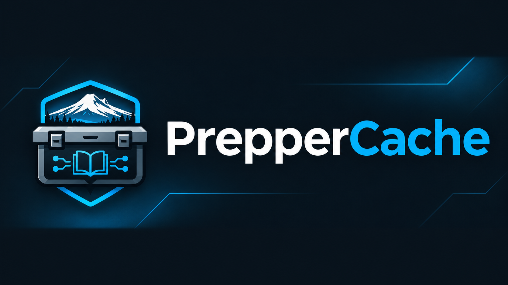

# PrepperCache



PrepperCache is an offline-first Raspberry Pi project for serving emergency preparedness, medical, survival, and general reference material on a local network.

[PrepperCache v1.0.1](https://github.com/A2ThreeD/PrepperCache/releases/tag/v1.0.1) serves an offline Kiwix library and maps from one local dashboard. The Settings page manages content, storage, Wi-Fi access, and optional GPIO accessories.

## Current Repository Layout

- `instructions.md` - original project requirements
- `scripts/bootstrap_pi.sh` - prepares a clean Raspberry Pi OS Lite system
- `scripts/install_preppercache.sh` - top-level installer for PrepperCache
- `scripts/build_kiwix_zim_manifest.py` - generates the ZIM manifest from the PrepperCache curated catalog
- `scripts/download_kiwix_zims.sh` - curated Kiwix ZIM downloader
- `scripts/select_install_profile.sh` - records first-start install choices for optional education add-ons
- `scripts/install_optional_components.sh` - installs optional education components from the selected profile
- `scripts/install_kolibri.sh` - installs Kolibri from Learning Equality's package source
- `scripts/install_ka_lite_legacy.sh` - guarded legacy path for KA Lite requests
- `scripts/configure_access_point.sh` - configures the Pi as a wireless access point for direct client access
- `scripts/install_portal_service.sh` - installs the local portal API service for setup state and live status
- `scripts/install_kiwix_service.sh` - installs and enables the local `kiwix-serve` systemd service
- `scripts/rebuild_kiwix_library.sh` - rebuilds the Kiwix `library.xml` from downloaded ZIM files
- `scripts/run_kiwix_service.sh` - runtime wrapper that starts Kiwix or a placeholder page when the library is empty
- `scripts/install_nginx_site.sh` - installs the Nginx site that serves `/`, `/kiwix`, `/maps`, `/admin`, and `/api`
- `app/preppercache_portal.py` - lightweight API for persisted PrepperCache setup state and Raspberry Pi status
- `config/preppercache.env.example` - template for editable install settings
- `config/install-profile.env.example` - template for first-start install profile defaults
- `config/kiwix-zim-urls.quick-test.txt` - tiny starter manifest for fast Kiwix validation
- `catalog/wikipedia.yaml` - selectable Wikipedia ZIM options for the configuration flow
- `docs/architecture.md` - stack and design notes
- `docs/release-checklist.md` - step-by-step validation list for fresh Pi installs and release testing
- `docs/software-plan.md` - software checklist for the Pi
- `web/admin/index.html` - settings and maintenance interface
- `web/maps/index.html` - offline PMTiles maps viewer powered by MapLibre

## Kiwix rebuild troubleshooting

Open **Details** on a content error to go straight to the Content Log. If Kiwix
rejects a ZIM, the log names the file. A rebuild indexes the readable archives
and leaves rejected files on disk so you can inspect or replace them. If Kiwix
cannot index any archives, PrepperCache keeps the previous library index.

## Intended Software Stack

- Raspberry Pi OS Lite
- Kiwix / `kiwix-serve`
- Nginx as the outer landing page / reverse proxy layer
- Avahi for local `.local` discovery on LAN
- Optional wireless AP mode for direct client access
- Custom admin and PMTiles-based maps components built in-repo

PrepperCache integrates the local portal, library, and offline map viewer into a single Raspberry Pi installation.

## Printable quick-start card

Use the [PrepperCache quick-start card](docs/PrepperCache-Quick-Start-US-Letter.pdf) with an already configured unit. Print it on US Letter paper at **Actual Size (100%)** and trim along the outline for a 4 × 6 inch card.

## Prepare a Raspberry Pi 4

You need a Raspberry Pi 4, a reliable power supply, an Ethernet connection or Wi-Fi credentials, and a quality microSD card. Use a **128 GB or larger** card for the base system and starter library; choose **256 GB or larger** if you plan to add larger Wikipedia editions, regional maps, or comprehensive ZIM collections.

### 1. Write the operating-system card

1. Install and open [Raspberry Pi Imager](https://www.raspberrypi.com/software/).
2. Select **Raspberry Pi 4**, then select **Raspberry Pi OS Lite (64-bit)** as the operating system.
3. Select the intended microSD card as storage. **Writing the image permanently erases all data on that card.** Confirm the selected capacity and name before continuing.
4. Open the Imager customization settings and set:
   - A username and strong password
   - Hostname: `preppercache`
   - Your Wi-Fi network, password, and wireless country (if not using Ethernet)
   - **Enable SSH** so the Pi can be configured remotely
5. Write the card, eject it cleanly, insert it into the Pi, connect networking, and power it on.

For the first installation, Ethernet is recommended: the installer downloads system packages and optional offline content.

### 2. Connect to the Pi

Wait a few minutes for the first boot, then from another computer on the same network run:

```bash
ssh <your-username>@preppercache.local
```

If `preppercache.local` does not resolve, find the Pi's address in your router's connected-device list and use `ssh <your-username>@<pi-ip>` instead.

### 3. Update the operating system

Before installing PrepperCache, update the newly installed operating system and reboot so any kernel or firmware update is active:

```bash
sudo apt update
sudo apt full-upgrade -y
sudo apt install -y git
sudo reboot
```

Reconnect with SSH after the Pi has restarted:

```bash
ssh <your-username>@preppercache.local
```

### 4. Clone and install PrepperCache

```bash
git clone --branch v1.0.1 https://github.com/A2ThreeD/PrepperCache.git preppercache
sudo ./preppercache/scripts/install_preppercache.sh
```

### 5. Complete setup

Open [PrepperCache](http://preppercache.local/) or use the Raspberry Pi's IP address. Select **Complete Setup** to download the offline library. After setup, open **Settings → Maps** to select and download maps.

The ZIM library is stored at `/library/zims/content`. Large libraries can take considerable time and storage; keep the Pi powered and connected to the network until the download finishes. If a download fails, PrepperCache reports the failed file, continues with the remaining content, and continues the installation. Run the download again to retry; incomplete downloads are kept in `.preppercache-download-tmp` in the destination directory. PrepperCache downloads up to three ZIM files at a time by default. Set `PREPPERCACHE_ZIM_DOWNLOAD_JOBS` to `1`, `2`, or `3` in `config/preppercache.env`. Existing ZIM files remain available during a refresh, which downloads a fresh copy before replacing them and therefore requires additional time and free space.

While setup runs, **Settings → Content** shows the current step and download progress. The installed library and disk usage appear automatically when setup finishes. A status panel at the bottom of PrepperCache pages follows active setup, content, and map jobs as you navigate. It links to job details and hides when there is nothing to show.

PrepperCache checks for interrupted content jobs at startup and once a minute. It resumes from the interrupted step and reuses partial downloads. Temporary network failures get up to three automatic retries. If a download still needs attention, use **Settings → Content → Resume Content Download** to retry it manually.

In **Settings → Content**, the highlighted button shows the current base set. Select another to review its contents and space requirements. Larger sets keep existing ZIMs. Switching to a smaller set requires explicit confirmation and permanently removes ZIMs outside that set from the local library and mounted PrepperCache library drives. PrepperCache verifies the smaller set is complete first.

**Update Content Now** checks the configured mirror and downloads newer editions alongside your existing files. Open **Update Schedule** to enable weekly updates while the Pi is on. The schedule is off by default. Failed downloads appear by filename in Content. Use **Add Content** to browse the mirror or download missing files.

Upload existing `.zim` archives from **Settings → Content** or **Settings → Files**. Drop the files into **Upload ZIM Files** or use **Choose ZIM Files**. Keep the page open until copying finishes. Files go to the content drive selected in Content, and PrepperCache starts a Kiwix library rebuild after the batch. Existing files with the same name are kept.

For troubleshooting, use **Settings → System → Export Troubleshooting Logs** to download recent setup, content, and map logs. Review the file before sharing it.

To apply interface updates to an existing Pi checkout without restarting PrepperCache, run `sudo bash scripts/install_web_pages.sh` from the checkout. After any active content or map jobs finish, run `sudo ./scripts/install_portal_service.sh` to apply backend changes.

## Moving an existing offline library

For a fresh install, use the steps above. For an in-place cutover, back up the current configuration, library index, and service definitions first. Existing ZIM and PMTiles archives can be reused without downloading them again. Set their locations in `config/preppercache.env` before activating the new services. Rebuild the Kiwix index to regenerate category tags and verify that all map archives appear in Settings. The old stack and PrepperCache cannot serve the same ports at the same time; plan the cutover after all active jobs finish.

Settings opens to the dashboard with a local overview of the installed library, map packages, service status, and system drive. On phones, use **Menu** to open Settings navigation.

Admin password protection is off by default. To enable it, go to **Settings → System → Admin Access**, check **Require an admin password**, and save a password. Settings then asks for that password without a username. **Admin Access** also lets you change the password, disable protection, or sign out. Kiwix and maps remain available without signing in.

The standard local installation uses HTTP. Set or enter the password on a trusted connection, or use HTTPS if you have configured it. If you forget the password, an administrator with shell access to the Pi can remove `admin-password.json` from the configured data directory (by default `/srv/preppercache/data`) and restart `preppercache-portal.service`. This turns protection off until you set a new password.

Settings tabs have direct links such as `/admin/#content` and `/admin/#maps`. **Add Content** and **Add Maps** open their respective catalogs. Review the items, destination, and storage estimate before starting a selected download. Failed files from an extra content batch and failed country or regional maps can be retried from their job status.

Under **Settings → WiFi**, edit the SSID and passphrase, then use **Save Config** to store the settings or **Apply Config** to apply them. Network and DHCP options are under **Advanced Settings**. The access point indicator appears in the header, and action results appear in the shared popup. The default network is `PrepperCache` with passphrase `prepperlocal`. Once connected, open `http://10.10.10.10`. The hotspot uses `10.10.10.0/24` and assigns addresses from `10.10.10.50` through `10.10.10.150`.

Under **Settings → About**, you can find the installed version, web update date, license, and project credits.

## Appearance

PrepperCache defaults to **Charcoal / Blue**. Choose **Light** under **Appearance** at the top right of **Settings**. See the [branding guide](docs/branding.md) for the artwork, palette, and styling conventions.

## Notes

- `catalog/kiwix-categories.yaml` is the source of truth for curated ZIM selection.
- The generated manifest in `config/kiwix-zim-urls.txt` is built from that YAML catalog using `PREPPERCACHE_ZIM_PROFILE`.
- The selected Wikipedia variant is controlled by `PREPPERCACHE_WIKIPEDIA_OPTION` and sourced from `catalog/wikipedia.yaml`.
- Supported profiles are `essential`, `standard`, and `comprehensive`. Standard adds Wikipedia Medicine without images, Appropedia, Post-Disaster Library, Sustainable Living Q&A, Hundred Rabbits, CD3WD, Low-tech Magazine, and Electronics Q&A. Comprehensive inherits those titles.
- **Settings → Content → Check Online Catalog** browses the selected ZIM mirror. Debian is the default. Setup and **Settings → Content** also offer the official Kiwix mirror and Dotsrc. The first refresh runs in the background. **Download Selected ZIMs** queues available selections and reports unavailable ones when the catalog is current.
- The home page is a vertical stack of cards. Project Gutenberg Library opens its Kiwix collection, and Medical & First Aid, Food and Water, Survival & Shelter, Repair, Communication, and Power and Energy open topic filters. Settings is the last card. Library rebuilds refresh the PrepperCache topic tags.
- Set `PREPPERCACHE_ZIM_MODE=quick-test` if you want a small validation download before pulling the full content set.
- The main page is now intended to be a first-start configuration screen with base install selected by default.
- The main page now switches automatically between first-start setup mode and the normal dashboard based on saved setup state.
- The setup page can now save preferences and trigger the backend apply workflow directly from the browser.
- Kiwix runs on a dedicated local port behind the main site's Nginx proxy.
- If no Kiwix library exists yet, the dedicated Kiwix port serves a placeholder page instead of crash-looping.
- `/maps` now expects a local PMTiles archive under the configured PMTiles root and renders it through MapLibre instead of a raster `z/x/y.png` tile tree.
- Optional education add-ons are tracked separately: `Kolibri` as a modern add-on, and `KA Lite` as a legacy add-on.
- `Kolibri` now has install automation in the repo. `KA Lite` requires an explicit legacy override and currently records the request rather than forcing a risky unattended install on modern Raspberry Pi OS.
- Wireless AP mode can be enabled through `config/preppercache.env` and applied by the installer or `scripts/configure_access_point.sh`.
- The installer now provisions `kiwix-serve`, the portal API, and an Nginx site so `/`, `/maps`, `/admin`, and `/api` are served on the main site, and Nginx proxies `/kiwix/` to the local Kiwix service.
- The interface uses the device's standard system font.
- Scrollable panels use white scrollbars on a dark track as a shared PrepperCache design rule. New scrollable boxes should keep that treatment for consistency.
- User-facing UI should describe upstream sources in generic terms like `regional map catalog` or `offline map packages` rather than adopting another project's branding as a primary label. Source attribution can still live in documentation or secondary status text when needed.

## Install offline maps

PrepperCache can extract a region from a larger Protomaps basemap and install it for offline use. MapLibre renders the resulting local archive through Nginx. In the viewer, **Choose a map** opens a region or individual map as soon as you select it. The viewer remembers your choice in the current browser. Expand **Go to coordinates** to enter a latitude, longitude, and zoom level.

1. The PrepperCache base installer installs the Protomaps CLI on 64-bit Raspberry Pi OS and Debian AMD64, checking the checksum before installing. For a manual install, download the [Protomaps `pmtiles` CLI](https://github.com/protomaps/go-pmtiles/releases) on the PrepperCache server. Choose the release for its OS and architecture (typically Linux ARM64 on a 64-bit Raspberry Pi OS install). Install the extracted binary with `sudo install -m 0755 pmtiles /usr/local/bin/pmtiles`.
2. PrepperCache finds a recent [Protomaps daily build](https://maps.protomaps.com/builds/) automatically. To use your own source or pin a build, set `PREPPERCACHE_MAP_BUILD_SOURCE` in `config/preppercache.env` to an absolute path to a local archive, such as `/library/sources/planet.pmtiles`, or copy a dated HTTPS URL from [Protomaps Builds](https://maps.protomaps.com/builds/). Keep the local source outside the installed maps folder so it stays out of the map picker. The source must be a clustered PMTiles v3 MVT archive with Protomaps basemap layers. The local source works offline. A remote source needs an internet connection and an HTTPS server that supports byte-range requests.

For country maps, open **Settings → Maps → Available Countries**. Filter by country name or ISO code, or use a quick-pick bundle. The picker shows estimated download size and free space on the selected destination. **Install Selected** extracts one country at a time through zoom 15, leaves existing maps in place, and skips countries already installed. Use **Map Jobs** to check progress or cancel the current extract and remaining queue. Any completed country maps stay installed and appear under **Country Maps** in the viewer. Country coverage uses bounding boxes, which can include neighboring areas.

For U.S. state bundles, open **Settings → Maps → U.S. Regions**. PrepperCache downloads the states in the selected regions directly from the same Protomaps source. It uses `pmtiles extract --region` with bundled [2025 Census Bureau cartographic state boundaries](https://www.census.gov/geographies/mapping-files/2025/geo/carto-boundary-file.html) at 1:5,000,000 scale. The job creates one archive per state and skips archives already extracted. Selecting a region in the viewer fits the combined bounds and displays every installed state in that region as you zoom. The size figures are rough planning estimates. Existing PMTiles remain available in the viewer and can be removed from **Manage Installed Maps**.

## Third-party credits

The country bounds, bundles, and size estimates are based on the [PrepperPi catalog](https://github.com/jmarler/prepperpi/blob/998a8f1c0beed00975b539c16acfeddd90f61c3a/services/prepperpi-tiles/regions.json), published under [MIT-0](https://github.com/jmarler/prepperpi/blob/998a8f1c0beed00975b539c16acfeddd90f61c3a/LICENSE). PrepperCache bundles the catalog for offline access, clips Antarctica’s south bound to Web Mercator’s limit, and extends United States coverage beyond the continental archive.

This workflow extracts existing vector tiles. Generating tiles from raw OSM extracts, arbitrary GeoJSON, or imagery requires a separate tile-building tool and a compatible map style.

## Validation

Use [release checklist](docs/release-checklist.md) when validating a fresh PrepperCache install or preparing a new release.


## Raspberry Pi accessories

Configure a physical shutdown button or a 0.91-inch OLED under **Settings → System → GPIO Accessories**. See the [wiring and setup guide](docs/gpio.md).

## License

PrepperCache's original code and documentation are available under the [MIT License](LICENSE). Third-party software, datasets, and downloaded content retain their own licenses.
